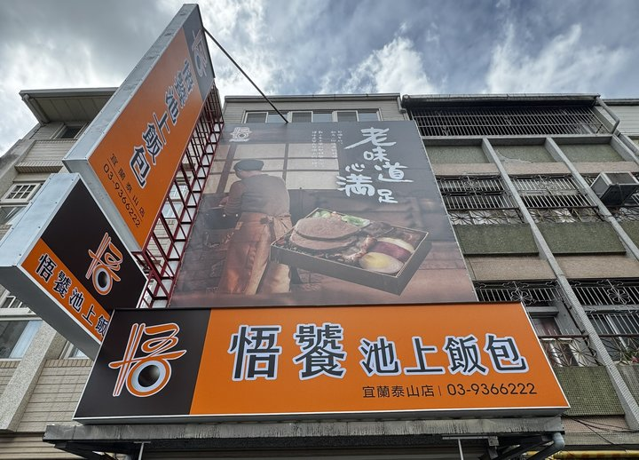
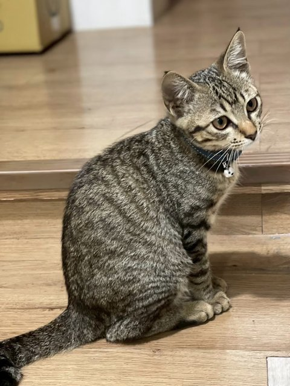
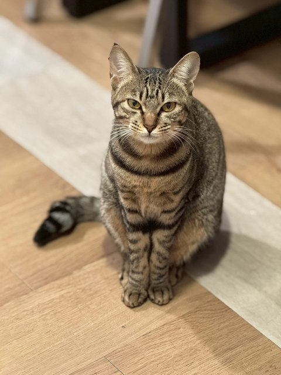

# 林其衞 Larry

**宜蘭最不正經、但很會做生意的房仲店長**

---

## 🎮 角色卡

| | |
|---|---|
| 🧑‍💼 **職業** | 房仲店長（有巢氏房屋 宜蘭黎明國小加盟店） |
| 🍱 **副職業** | 便當店老闆、留白事務所總經理、自學工程師 |
| 🧠 **天賦** | 看到重複的事就忍不住寫成程式 |
| 🏍️ **坐騎** | 重機 |
| 🐈 **寵物** | 虎斑貓（實際上是牠養我） |
| 🗺️ **主城** | 宜蘭 |
| 💬 **口頭禪** | 「這個可以自動化吧？」 |

## 🗺️ 我開的副本

<table>
<tr>
<td width="50%" valign="top">

**🍱 便當店（宜蘭泰山店）** 
自己下海開便當店，才知道小店老闆每天被排班、算薪水、對帳追著跑。後來把店裡的打卡算薪、記帳、股東帳務全部寫成系統，現在整理成開源專案 **[tw-shop-staff](https://github.com/Larryveryhandsome/tw-shop-staff)**。
</td>
<td width="50%" valign="top">

**🏠 有巢黎明（房仲本業）** 
有巢氏房屋 宜蘭黎明國小加盟店。家所在，擇你愛。客戶、物件、行程全部用自己寫的 LINE 機器人加中控台管理。
</td>
</tr>
<tr>
<td valign="top">

**🧹 HESON 赫頌家事管理** 
家裡的另一個事業。我幫它寫了整套「線上估價 → 接單 → 派工 → 結算」系統，之後會整理成 **tw-dispatch-kit** 開源。
</td>
<td valign="top">

**🛋️ 留白事務所** 
網頁設計、遠端房仲助理、AI 落地。幫在地店家做網站，也幫房仲把雜事交給 AI。
</td>
</tr>
</table>

## 🔧 我做的東西

| 專案 | 一句話 | 連結 |
|---|---|---|
| 🧮 **土增稅神器** | 輸入地號就能算土地增值稅，給房仲和代書用（App＋網頁版） | [calc.zengzhisui.com](https://calc.zengzhisui.com) ・ [原始碼](https://github.com/Larryveryhandsome/lvit-calc) |
| 🏦 **青安 3.0 房貸試算** | 資格、額度、利息補貼、每月還款一次算清楚，資料不離開瀏覽器 | [線上試算](https://larryveryhandsome.github.io/qing-an-3-calculator/) ・ [原始碼](https://github.com/Larryveryhandsome/qing-an-3-calculator) |
| 🎨 **qicai-paint** | 跨品牌油漆色號對照：「這個顏色在別家叫什麼？」 | [原始碼](https://github.com/Larryveryhandsome/qicai-paint) |
| 🏪 **tw-shop-staff** | 小店的員工＋股東系統：手機打卡、**依勞基法算薪**、記帳核銷、股東帳務網站。10 種行業實測過 | [原始碼](https://github.com/Larryveryhandsome/tw-shop-staff) |
| 🏡 **tw-listing-page** | 房仲物件介紹頁模板：填一個資料檔，就有經紀人首頁、物件頁、投資試算、行情報告 | [線上試用](https://larryveryhandsome.github.io/tw-listing-page/) ・ [原始碼](https://github.com/Larryveryhandsome/tw-listing-page) |
| 🗓️ **tw-duty-roster** | 自動值班排班表：門市、小店用，規則可調、請假、列印與匯出 Excel | [線上試用](https://larryveryhandsome.github.io/tw-duty-roster/) ・ [原始碼](https://github.com/Larryveryhandsome/tw-duty-roster) |
| 🔎 **tw-listing-lookup** | 售版編號查詢：輸入編號查地址、承辦人，資料放 CSV 或試算表 | [線上試用](https://larryveryhandsome.github.io/tw-listing-lookup/) ・ [原始碼](https://github.com/Larryveryhandsome/tw-listing-lookup) |
| 🚗 **tw-showing-route** | 集體帶看行程表：自動排出最順的順序，附地圖與 Google 地圖導航 | [線上試用](https://larryveryhandsome.github.io/tw-showing-route/) ・ [原始碼](https://github.com/Larryveryhandsome/tw-showing-route) |
| ⚡ **tw-submeter-bill** | 分租套房電費計算：依台電帳單或每度單價分攤、公共用電、換表、列印繳費通知單 | [線上試用](https://larryveryhandsome.github.io/tw-submeter-bill/) ・ [原始碼](https://github.com/Larryveryhandsome/tw-submeter-bill) |
| 📋 **tw-progress-report** | 案場／專案進度彙報：待辦、計畫、客戶追蹤自動遮名，一鍵產生 LINE 文字版 | [線上試用](https://larryveryhandsome.github.io/tw-progress-report/) ・ [原始碼](https://github.com/Larryveryhandsome/tw-progress-report) |
| 📝 **tw-property-sheet** | 物調表自動產生器：地址查公開資料、上傳謄本自動填坪數樓層屋齡，一鍵產生 A4 Excel | [原始碼](https://github.com/Larryveryhandsome/tw-property-sheet) |
| 🗺️ **tw-lvr-map** | 實價登錄地圖：政府開放資料畫成地圖，篩選、單價中位數、匯出 CSV | [線上試用](https://larryveryhandsome.github.io/tw-lvr-map/) ・ [原始碼](https://github.com/Larryveryhandsome/tw-lvr-map) |
| 💬 **tw-line-faq-bot** | 小店 LINE 客服：FAQ 自動回，答不出來推按鈕卡給老闆點一下就回，可選 Claude 補答 | [原始碼](https://github.com/Larryveryhandsome/tw-line-faq-bot) |
| 🛵 **tw-gig-dispatch** | 地推／外包夥伴派工：依區域派店、手機回報、防灌水核實、每月獎金結算 | [原始碼](https://github.com/Larryveryhandsome/tw-gig-dispatch) |
| 📡 **tw-local-needs** | 在地需求雷達：地方生活需求提交、去識別化公開、後台媒合在地服務者 | [線上試用](https://larryveryhandsome.github.io/tw-local-needs/) ・ [原始碼](https://github.com/Larryveryhandsome/tw-local-needs) |
| 🩺 **tw-health-monitor** | 自架服務每日健康巡檢：純唯讀，服務停了、DB 膨脹、磁碟快滿才通知 | [原始碼](https://github.com/Larryveryhandsome/tw-health-monitor) |
| 📄 **tw-pdf2jpg** | PDF 轉 JPG／PNG：全部在瀏覽器處理，合約謄本不用丟到別人網站 | [線上使用](https://larryveryhandsome.github.io/tw-pdf2jpg/) ・ [原始碼](https://github.com/Larryveryhandsome/tw-pdf2jpg) |
| 🌐 **網頁作品** | 留白事務所官網＋幫在地店家做的官網示範 | [留白事務所](https://larryveryhandsome.github.io/blank-office-site/) ・ [牙醫](https://larryveryhandsome.github.io/DENTAL-SAMPLE/) ・ [建案](https://larryveryhandsome.github.io/The-Time-of-Silence-SAMPLE/) ・ [動物醫院](https://larryveryhandsome.github.io/SAMPLE-32/) |

### 🚧 下一批要開源的

- [x] **tw-shop-staff**：門市員工＋股東系統（[已開源](https://github.com/Larryveryhandsome/tw-shop-staff)）
- [ ] **tw-dispatch-kit**：到府服務接單派工
- [ ] **tw-office-hub**：業務型辦公室中控台
- [ ] **tw-social-radar**：品牌社群雷達（只產草稿，一律人工發）

## 🧠 做事方法（正經版）

1. **先自己用，再拿出來給別人用。** 開源的東西都在真的店裡跑過。
2. **形式可以不正經，實質一律正經。** 碰到錢、法規、員工權益，一定照規矩來。
3. **AI 做苦工，人做判斷。** 要對外發出去的，一律人看過才發。

## 🌠 夢想清單

人要有夢想，萬一實現了呢？

- [ ] 🏎️ **保時捷 911 Carrera**（目前進度：已經站在展示中心門口拍照）
- [ ] ⌚ **勞力士 Daytona 玫瑰金**
- [ ] 🏍️ **杜卡迪 Diavel V4**
- [x] 🐈 **養貓**（已達成）

靠賣房子、做系統、開便當店一步一步來。哪天打勾了，會回來更新這一頁。

 

## 🐈 本帳號吉祥物

不會寫程式，但很會躺在鍵盤上幫忙 commit。

## 🛠️ 裝備

`Python` `JavaScript` `React Native` `Flutter` `SQLite` `LINE Messaging API` `Playwright` `Claude` `Cloudflare`

## 🤝 找我

- 📧 **Email**：[larry87tw@gmail.com](mailto:larry87tw@gmail.com)
- 🐛 用我的開源專案遇到問題 → 到該專案開 Issue
- 🏠 想在宜蘭買房、賣房 → 有巢氏房屋 宜蘭黎明國小店

